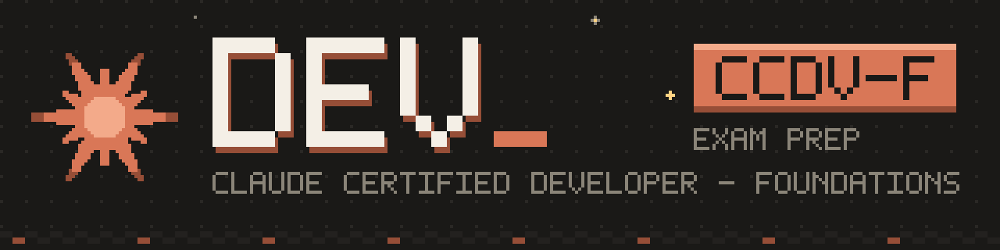

<div align="center">



<br>

[](https://aimanamri.github.io/claude-dev-exam-prep/)
[](https://github.com/aimanamri/claude-dev-exam-prep/actions/workflows/pages.yml)


**Notes, practice exams and a timed exam simulator for the Claude Certified Developer – Foundations certification.**

[Quick start](#quick-start) · [Study path](#study-path) · [Exam site](#practice-exam-site) · [Helpdesk project](#helpdesk-project) · [Repo map](#repo-map)


</div>

## Quick start

Pick the path that matches where you are.

| I want to… | Go to |
|---|---|
| **Test myself now** | [Open the live exam site](https://aimanamri.github.io/claude-dev-exam-prep/): nothing to install |
| **Learn the material** | [`00-mso-foundations-notes.md`](00-mso-foundations-notes.md), then [`01-full-study-notes.md`](01-full-study-notes.md) |
| **Revise on the move** | [`02-commute-recall.md`](02-commute-recall.md): short recall cards and number/header flash lists |
| **See it applied** | [`helpdesk-project/`](helpdesk-project/00-README.md): one IT-helpdesk assistant built across every module |

## Study path

A suggested order. Each step feeds the next.

| Step | Do this | Why |
|:-:|---|---|
| **1** | Read the M1 notes ([`00`](00-mso-foundations-notes.md)) and try its 10-question mini set | Tokens, context window, sampling, model tiers, prompting modes, SDK/REST/streaming/batch |
| **2** | Read the full notes ([`01`](01-full-study-notes.md)) | M2–M5: must-remember facts, syntax, debug priority, trade-offs and fixes |
| **3** | Walk through the [helpdesk project](helpdesk-project/00-README.md) | See each module's decision in one realistic build |
| **4** | Take Sets A–D in **Practice mode** | Check each answer as you go and read the reasoning |
| **5** | Take mock Sets E–H and hard Sets I–J in **Exam mode** | 40 Q / 60 min and 30 Q / 60 min, answers at the end |
| **6** | Run the **Must-Remember drill** and retry what you missed | 393 shuffled questions; weak modules show up in the score report |

## Practice exam site

**Live:** https://aimanamri.github.io/claude-dev-exam-prep/ (rebuilt by GitHub Actions on every push to `main`)

| Sets | Format |
|---|---|
| A–D, M1 mini set | Core practice sets |
| E–H | Mock exams: 40 Q / 60 min |
| I–J | Hard Good/Better/Best sets: 30 Q / 60 min |
| Must-Remember | Shuffled drill across all 393 questions |

**Features:** Pearson-style screen with timer, pause/resume, flag for review, review grid and strike-out · Exam mode (answers at the end) or Practice mode (check as you go) · score report with per-module breakdown and reasoning for every answer · "retry missed" · progress and history kept in your browser's `localStorage`.

<details>
<summary><b>Run it locally</b></summary>

Python 3 only, no dependencies.

```bash
cd quiz-site
python3 server.py --open      # http://localhost:8765
```

</details>

<details>
<summary><b>Add your own set</b></summary>

Drop a markdown file into `quiz-site/sets/`. Press **Reload sets** locally, or push to `main` to update the live site. See [`quiz-site/FORMAT.md`](quiz-site/FORMAT.md) for the format and a prompt that asks Claude to generate one.

</details>

## Helpdesk project

One IT-helpdesk assistant, grown in stages from a single prompt to a governed multi-tool agent. It handles Active Directory accounts, passwords, Microsoft 365 and network/firewall tickets, and shows which design decision each module teaches. Start at the [overview](helpdesk-project/00-README.md).

| # | Stage | # | Stage |
|:-:|---|:-:|---|
| 1 | [Requirements and design](helpdesk-project/01-requirements-and-design.md) | 6 | [Memory design](helpdesk-project/06-memory-design.md) |
| 2 | [Basic prompt](helpdesk-project/02-stage1-basic-prompt.md) | 7 | [Evaluation and testing](helpdesk-project/07-evaluation-and-testing.md) |
| 3 | [Tool-use agent with human-in-the-loop](helpdesk-project/03-stage2-tool-use-agent.md) | 8 | [RPA and automation](helpdesk-project/08-rpa-and-automation.md) |
| 4 | [MCP integration](helpdesk-project/04-mcp-integration.md) | 9 | [Deployment, cost and operations](helpdesk-project/09-deployment-cost-operations.md) |
| 5 | [Security and governance](helpdesk-project/05-security-and-governance.md) | | |

## Repo map

```text
.
├── 00-mso-foundations-notes.md   M1 Foundations + 10-question mini set
├── 01-full-study-notes.md        M2–M5 notes
├── 02-commute-recall.md          recall cards
├── 03-practice-exams.md          Sets A–D with answers and reasoning
├── helpdesk-project/             worked IT-helpdesk assistant, one file per stage
├── quiz-site/                    timed exam site (server.py, static build, sets/)
├── prompts/                      prompt used to build the sibling Architect pack
├── assets/                       README pixel art and the script that generates it
└── Developer Exam Prep.md        Obsidian index note
```

The notes are Obsidian-flavoured markdown (`[[wikilinks]]`) but read fine anywhere.

## Disclaimer

Unofficial study material, written from the course modules for personal exam preparation. Confirm version-specific details (model IDs, prices, limits, beta headers) at [platform.claude.com](https://platform.claude.com) before relying on them.

<div align="center">
<sub>Pixel art in <code>assets/</code> is generated by <a href="assets/make_art.py"><code>make_art.py</code></a>.</sub>
</div>
